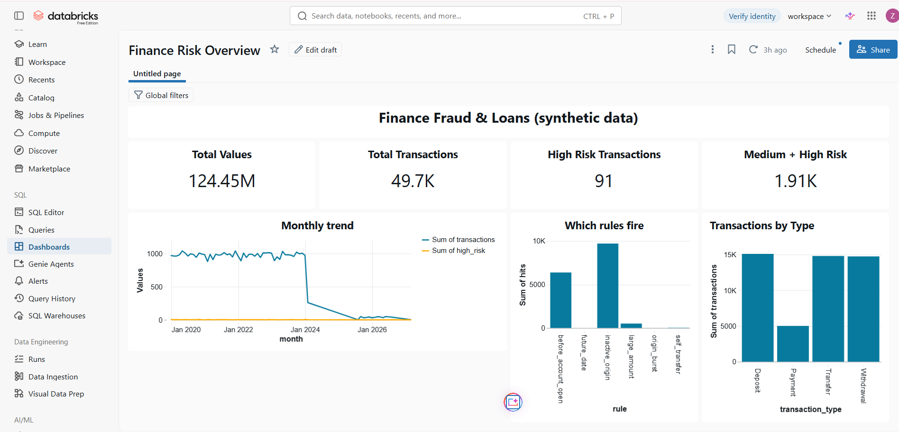

# Finance Fraud & Loans: Lakeflow Declarative Pipeline

A medallion pipeline (bronze, silver, gold) built on **Databricks Free Edition** with Lakeflow Spark
Declarative Pipelines, Auto Loader and Unity Catalog. It turns the TestDataBox synthetic finance dataset
(11 CSVs, about 50k transactions, about 7% injected data-quality errors) into a star schema, a rule-based
anomaly score and an AI/BI dashboard.



## Architecture

```
```

Catalog `finance`: schema `raw` (volume), pipeline output in schema `lakeflow`.

## Layout
| Path | Purpose |
|---|---|
| `transformations/01_bronze.py` | 11 streaming tables via Auto Loader |
| `transformations/02_silver.py` | Cleaning, mixed-date parsing, country-typo repair, dedupe, expectations, quarantine |
| `transformations/03_gold.py` | Dimensions, facts, risk rules, dashboard aggregates |
| `dashboard/queries.sql` | The SQL datasets behind the dashboard |
| `sample/transactions_batch2.csv` | 201-row second batch for the incremental-load demo |
| `docs/` | Screenshots |

## Setup
1. In Catalog create `finance`, schema `raw`, and a volume named `volume`.
2. In the volume create one folder per table (`customers`, `accounts`, `loans`, `transactions`, `branches`,
   `addresses`, `customer_types`, `account_types`, `account_statuses`, `loan_statuses`, `transaction_types`)
   and upload each CSV into its folder.
3. Jobs & Pipelines, Create, ETL pipeline. Default catalog `finance`, schema `lakeflow`, serverless compute.
   Add the three files in `transformations/` as source code.
4. Optional settings: `raw_path` (default `/Volumes/finance/raw/volume`), `burst_threshold` (3),
   `large_amount_percentile` (0.99).
5. Run it, then create the dashboard from `dashboard/queries.sql`.

Incremental demo: drop `sample/transactions_batch2.csv` into `transactions/` and run again. Bronze grows by
201 rows, silver by 195 after de-duplication, and 3 bad rows land in quarantine.

## Data profile findings
- **No fraud label exists.** The source readme mentions `is_fraud`, but `transactions.csv` has no such column.
  The risk score is a rules-based anomaly score, not a measured fraud rate.
- Transactions: 500 exact duplicate rows, 1,000 blank dates, 30 self-transfers, no orphan account keys.
- Accounts: 16 duplicate keys, 33 blank opening dates. Customers: 11 duplicate keys, about 22 blank names.
- Dates arrive in mixed formats, including ISO with a `T`. Format order matters (`yyyy-MM-dd` before
  `yyyy-dd-MM`). 22 customer dates are literally `NaT` and become NULL.
- Address countries contain typos ("Unitd States"), repaired with a Levenshtein distance of 2 or less.
- Most transactions fall in 2020 to 2023 and volume drops sharply from early 2024. Raw and parsed dates
  were compared, so this comes from the source data, not the pipeline.

## Risk rules (`gold_fct_transaction_risk`)
| Rule | Weight |
|---|---|
| Amount at or above the 99th percentile for its transaction type | 3 |
| Origin account inactive or closed | 2 |
| Origin equals destination | 2 |
| Future-dated | 2 |
| Before origin account opening | 1 |
| 3 or more transactions by the same origin in a day | 1 |

Bands: 5+ high, 3 to 4 medium, 1 to 2 low.

## Results
50,000 raw transactions give 49,500 clean rows in the first load (500 exact duplicates removed). Dashboard headline:
about 49.7k transactions worth 124.45M, 91 high-risk and 1.91k medium-or-high after the second batch.

## Known limitations
- Rules only, no labels, so there is no precision or recall. Treat bands as review priority.
- "Before account opening" fires on about 13% of rows in this synthetic data, so it is weighted low.
  Some medium rows are driven by weak rules alone.
- Serverless runs with ANSI mode on, so the code uses `try_cast` and `try_to_timestamp`.
- Pipelines cannot take over tables created by notebooks, hence the separate `lakeflow` schema.

## Next steps
Schedule the pipeline as a daily job, add SCD2 on accounts with `create_auto_cdc_flow`, connect Power BI
to the gold tables through the Databricks connector.
